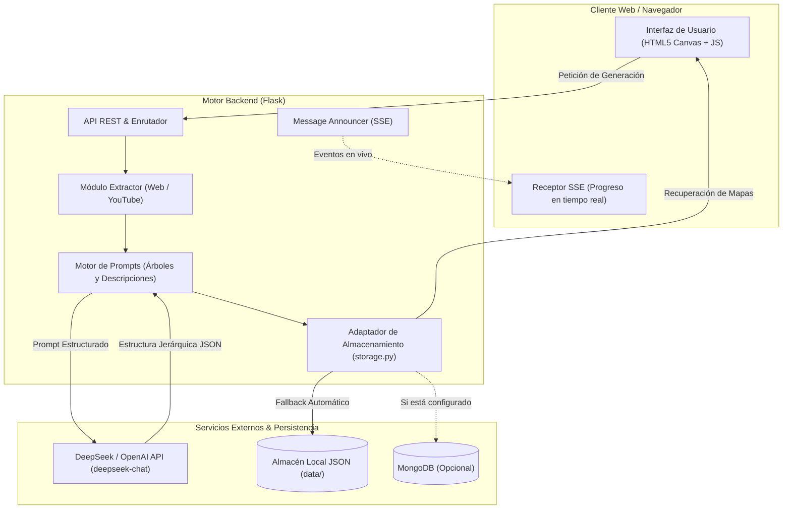

# MindMapGenerator 🧠⚡

[](https://opensource.org/licenses/MIT)
[](https://www.python.org/)
[](https://flask.palletsprojects.com/)
[](https://deepseek.com)
[](https://github.com/jlcostumero/MindMapGenerator)

Generador interactivo y motor autónomo de **mapas mentales y esquemas conceptuales asistidos por Inteligencia Artificial**. Convierte temas libres, textos densos, páginas web o transcripciones automáticas de vídeos de YouTube en esquemas jerárquicos visuales, interactivos y exportables (PNG, PDF, TXT).

---

## 🚀 Características Principales

- **Generación Asistida por IA**: Compatible con modelos de lenguaje avanzados vía API REST (DeepSeek-V3, DeepSeek-Chat o OpenAI GPT-4o / GPT-3.5).
- **Entrada Multicanal**:
  - 📝 **Texto Libre y Temas**: Generación a partir de cualquier concepto, apunte o artículo.
  - 🌐 **Web Scraping Integrado**: Extracción y síntesis inteligente a partir de cualquier URL pública.
  - 🎥 **Transcripción de YouTube**: Descarga y síntesis directa de vídeos sin necesidad de visualizar manualmente el contenido.
- **Transmisión en Tiempo Real (SSE)**: Feedback en vivo con Server-Sent Events durante el proceso de análisis, estructuración y desglose de nodos.
- **Visualizador Interactivo y Exportación**: Navegación por árboles y ramas, modo oscuro/claro y exportación con un clic a formatos PDF, PNG y esquema de texto indentado.
- **Persistencia Desacoplada e Híbrida**: Funciona de forma inmediata con almacenamiento local en JSON (`data/`) o conectado a una instancia de MongoDB si está disponible.

---

## 🏛️ Arquitectura del Sistema



---

## 🛠️ Instalación y Uso Rápido

### 1. Clonar el repositorio
```bash
git clone https://github.com/jlcostumero/MindMapGenerator.git
cd MindMapGenerator
```

### 2. Crear y activar entorno virtual
```bash
python -m venv venv
# En Windows:
venv\Scripts\activate
# En Linux/macOS:
source venv/bin/activate
```

### 3. Instalar dependencias
```bash
pip install -r requirements.txt
```

### 4. Configurar variables de entorno
Copia la plantilla de entorno:
```bash
cp .env.example .env
```
Edita `.env` con tu clave de API de DeepSeek u OpenAI:
```env
DEEPSEEK_API_KEY=tu_api_key_aqui
SECRET_KEY=clave_aleatoria_para_sesion
```

### 5. Iniciar la aplicación
```bash
python app.py
```
Abre tu navegador en `http://localhost:1000`.

---

## ⚙️ Variables de Entorno

| Variable | Descripción | Valor por Defecto |
| :--- | :--- | :--- |
| `DEEPSEEK_API_KEY` | Clave API de DeepSeek u OpenAI | *(Requerido)* |
| `DEEPSEEK_BASE_URL` | Endpoint base de la API | `https://api.deepseek.com/v1` |
| `DEEPSEEK_MODEL` | Identificador del modelo | `deepseek-chat` |
| `SECRET_KEY` | Clave de firma para sesiones Flask | Generada aleatoriamente |
| `MONGO_URI` | Cadena de conexión a MongoDB | *(Opcional - usa almacenamiento local si no se define)* |
| `MONGO_DB` | Nombre de la base de datos | `maps` |
| `YOUTUBE_PROXY` | Proxy HTTP para youtube-transcript-api | *(Opcional)* |
| `HOST` | Host de escucha | `0.0.0.0` |
| `PORT` | Puerto de escucha | `1000` |

---

## 📦 Estructura del Repositorio

```text
MindMapGenerator/
├── prompts/                      # Plantillas de prompts especializadas
│   ├── consulta.txt             # Síntesis y extracción conceptual
│   ├── consultaarbol.txt        # Estructuración jerárquica en árbol
│   └── consultadescripciones.txt # Generación de tarjetas y detalles de nodo
├── templates/                    # Vistas HTML (Jinja2)
│   ├── index.html               # Portal principal de generación
│   ├── map.html                 # Visualizador interactivo de mapas
│   └── calculo.html             # Pantalla de carga y progreso SSE
├── css/                          # Estilos del visualizador y chat
├── js/                           # Motores interactivos y exportadores (PDF, Canvas)
├── resources/                    # Iconos y tipografías
├── app.py                        # Servidor Flask principal y API de generación
├── config.py                     # Módulo centralizado de configuración (.env)
├── storage.py                    # Persistencia híbrida (MongoDB / Local JSON)
├── requirements.txt              # Dependencias de Python depuradas
├── .env.example                  # Plantilla de variables de entorno
└── LICENSE                       # Licencia MIT
```

---

## 📄 Licencia

Este proyecto está bajo la Licencia **MIT** - consulta el archivo [LICENSE](LICENSE) para más detalles.

---

**Autor**: [Jose Luis Costumero Burgos](https://github.com/jlcostumero)  
*Neural Maps AI / Generación Aumentada de Conocimiento*
